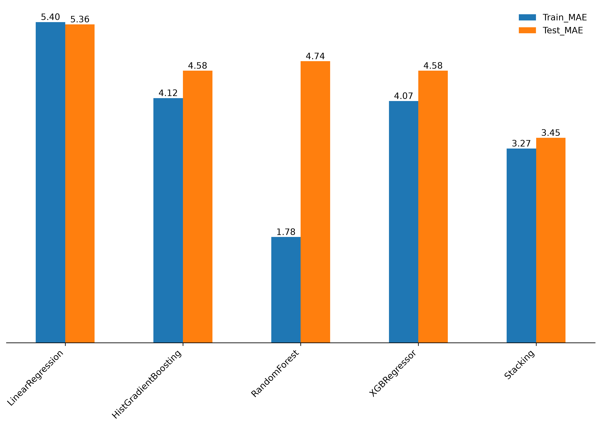

# 📦 Olist Delivery Time Estimation

**Team:** Nebras Jafail · Fatema Shaker · Fatema Butaher · Noora Alkhalaqi (DSB3)
**Live demo:** [olist-delivery-estimation-app.streamlit.app](https://olist-delivery-estimation-app.streamlit.app)

---

## Problem Statement

Customers abandon their carts when they cannot see when an order will arrive: typical delivery on Olist takes about 10 days, but 1 in 10 orders takes more than 3 weeks. We built a regression model that predicts the delivery time in days for every seller at checkout, so the customer sees a trusted delivery date before pressing "Order Now".

---

## Executive Summary

We combined the 7 public Olist files into one table with one row per ordered item. We removed contradictory orders (for example "delivered" with no delivery date), items with no product category, and rows missing key fields, and merged repeat purchases of the same item into one row with a quantity. Only delivered orders were kept, because a real delivery time is needed to learn from, which leaves **98,767** orders. Seller IDs were replaced with simple labels (seller 1, seller 2, …). We engineered the seller-to-customer distance from zip-code coordinates, a same-state flag, product volume, and the purchase month, weekday, day and hour. Smaller gaps (weight, size, location) were filled with the median for numbers and `"missing"` for categories.

The target is `delivery_days` (purchase date to delivery date) and the metric is **Mean Absolute Error (MAE)**: the average number of days the estimate is off, which matches how customers judge an early or late delivery. We compared five models on the same train/test split: Linear Regression, HistGradientBoosting, Random Forest, XGBoost and a **Stacking ensemble** (we also tried KNN, which performed poorly). Linear Regression scored about 5.4 days of MAE and underfits. Random Forest fits the training data very closely (about 1.8 days) but drops to about 4.7 days on unseen data, which is a clear sign of overfitting. The tuned HistGradientBoosting model reached about 4.6 days on unseen orders.

**We chose the Stacking model for the Streamlit app.** It combines three tree-based models (HistGradientBoosting, Random Forest and Extra Trees) and lets a Ridge regression learn how to weigh their predictions. The target is log-transformed during training (`log1p`) to handle the skewed delivery times, and the predictions are converted back to days. On unseen orders it reached an **MAE of 4.39 days** (train MAE 3.67 days), compared with [4.58] days for XGBoost, about 4.6 days for HistGradientBoosting and about 5.4 days for the Linear Regression baseline.

The strongest signals in the data match common sense. Distance and delivery time are correlated (0.39), only 36% of orders have the customer and seller in the same state, and freight value tracks product weight and volume (about 0.60). We recommend showing the model's estimate at checkout to reduce cancellations (our business target is 12%) and to improve customer satisfaction. We deployed the Stacking model in a Streamlit app that simulates the customer journey: location, product, sellers ranked by predicted delivery time, checkout and confirmation.

---

## Table of Contents

```
OLIST_DATE_ESTIMATION/
├── README.md
├── Data/
│   └── cleaned/
│       └── olist_clean.csv        # final cleaned table used for modeling
├── Code/
│   └── Olist_Delivery_Estimation_Model.py
├── olist-app/                     # deployed Streamlit app
│   ├── model2_app.py
│   ├── delivery_model.joblib      # trained Stacking model used by the app
│   ├── app_customers.csv
│   ├── app_offers.csv
│   └── requirements.txt
└── Presentation/
    ├── Olist_delivery_model.pdf
    └── images/
        └── model_mae_comparison.png
```

---

## Data and Data Dictionary

**Source:** the [Brazilian E-Commerce Public Dataset by Olist](https://www.kaggle.com/datasets/olistbr/brazilian-ecommerce) on Kaggle: about 100k orders placed at multiple marketplaces in Brazil between 2016 and 2018. The data is released under the CC BY-NC-SA 4.0 license, so this project is non-commercial. We used 7 of the files: orders, customers, order items, sellers, products, geolocation and the category name translation.

### Final cleaned file: `olist_clean.csv` (one row per ordered item)

| Feature | Type | Description |
|---|---|---|
| `order_id` | string | Unique order identifier |
| `customer_id` | string | Customer identifier for the order |
| `order_status` | string | Order status (only delivered orders remain) |
| `order_purchase_timestamp` | datetime | When the customer placed the order |
| `order_delivered_customer_date` | datetime | When the customer received the order |
| `customer_state` | string | State of the customer |
| `customer_zip_code_prefix` | int | First digits of the customer's zip code |
| `product_id` | string | Product identifier |
| `seller_id` | string | Original seller identifier |
| `seller_id_new` | string | Simplified seller label (`seller 1`, `seller 2`, …) |
| `seller_state` | string | State of the seller |
| `seller_zip_code_prefix` | int | First digits of the seller's zip code |
| `product_category_name_english` | string | Product category (translated to English) |
| `product_weight_g` | float | Product weight in grams |
| `price` | float | Item price in Brazilian reais (R$) |
| `freight_value` | float | Shipping cost of the item in R$ |
| `customer_lat`, `customer_lng` | float | Average coordinates of the customer's zip-code prefix |
| `seller_lat`, `seller_lng` | float | Average coordinates of the seller's zip-code prefix |

### Engineered features

| Feature | Description |
|---|---|
| `delivery_days` | **Target.** Days from purchase to delivery: (delivered date − purchase date) in days |
| `dist_km` | Distance in km between seller and customer (haversine formula on the zip-code coordinates) |
| `same_state` | 1 if the seller and the customer are in the same state, otherwise 0 |
| `vol` | Product volume = length × height × width (cm³) |
| `quantity` | Number of identical items bought in the same order (repeat rows merged into one) |
| `month`, `dow`, `day`, `hour` | Purchase month, day of the week, day of the month and hour (created at the modeling stage from the purchase timestamp) |

### Model inputs

**Comparison models (Linear Regression, HistGradientBoosting, Random Forest, XGBoost), 15 features:** `customer_zip_code_prefix`, `freight_value`, `seller_state`, `customer_state`, `seller_zip_code_prefix`, `product_weight_g`, `dist_km`, `same_state`, `vol`, `product_category_name_english`, `quantity`, `month`, `dow`, `day`, `hour`

**Stacking model (used in the app):** 'customer_zip_code_prefix', 'freight_value', 'seller_state', 'customer_state', 'seller_zip_code_prefix', 'product_weight_g', 'dist_km', 'same_state', 'vol', 'product_category_name_english', 'quantity', 'month', 'dow', 'day', 'hour', 'is_weekend', 'weight_to_dist', 'log_dist', 'log_weight', 'log_vol','weight_x_dist', 'log_weight_dist'. The three categorical features (`customer_state`, `seller_state`, `product_category_name_english`) are ordinal-encoded, and the target is transformed with `log1p`.

### App files

| File | Description |
|---|---|
| `app_customers.csv` | One row per customer zip code, with its state and coordinates |
| `app_offers.csv` | One row per seller in each category: location, min/max price, number of products, and median freight, weight and volume |

---

## Key Visualizations

**Model comparison (MAE in days, train vs. test):**



Linear Regression underfits (high error on both sets) and Random Forest overfits (a large gap between train and test). The Stacking model, the one we deployed, combines HistGradientBoosting, Random Forest and Extra Trees and reached a test MAE of 4.39 days.

---

## Conclusions and Recommendations

**Conclusions**
- We chose the **Stacking model** (HistGradientBoosting + Random Forest + Extra Trees, combined by a Ridge model, with a log-transformed target) for the app. It predicts delivery time with an MAE of **4.39 days** on unseen orders, compared with about 5.4 days for the Linear Regression baseline.
- Location drives delivery time: distance and delivery days are correlated (0.39), and only 36% of orders stay inside one state.
- Random Forest alone looked best on training data but did not generalize, so the train/test gap, not the training score, guided our choices.

**Recommendations**
- Show the predicted delivery date at checkout, before "Order Now", to reduce cancellations and raise customer satisfaction.
- Treat the estimate as a range of about ±[X] days rather than an exact promise, and monitor the real error after launch.

---

## Areas for Further Research

- **Shipping cost:** our app does not show it, because the `freight_value` in the app is each seller's median across all destinations and does not change with the customer's location. A destination-specific estimate (median per seller and customer state) would fix this.
- **More features:** seller processing time, carrier, holidays and weather, and product dimensions per item.
- **Better location data:** use full zip codes or city-level data instead of zip-code prefix averages.
- **Speed:** the Stacking model trains several models and predicts more slowly than a single one, so a lighter model could be tested if the app grows.

---

## Sources

- Olist, [Brazilian E-Commerce Public Dataset by Olist](https://www.kaggle.com/datasets/olistbr/brazilian-ecommerce), Kaggle (CC BY-NC-SA 4.0).
- scikit-learn documentation: [StackingRegressor](https://scikit-learn.org/stable/modules/generated/sklearn.ensemble.StackingRegressor.html), [TransformedTargetRegressor](https://scikit-learn.org/stable/modules/generated/sklearn.compose.TransformedTargetRegressor.html), [HistGradientBoostingRegressor](https://scikit-learn.org/stable/modules/generated/sklearn.ensemble.HistGradientBoostingRegressor.html), [RandomizedSearchCV](https://scikit-learn.org/stable/modules/generated/sklearn.model_selection.RandomizedSearchCV.html), [GridSearchCV](https://scikit-learn.org/stable/modules/generated/sklearn.model_selection.GridSearchCV.html).
- [Streamlit documentation](https://docs.streamlit.io) and [Streamlit Community Cloud](https://streamlit.io/cloud).
